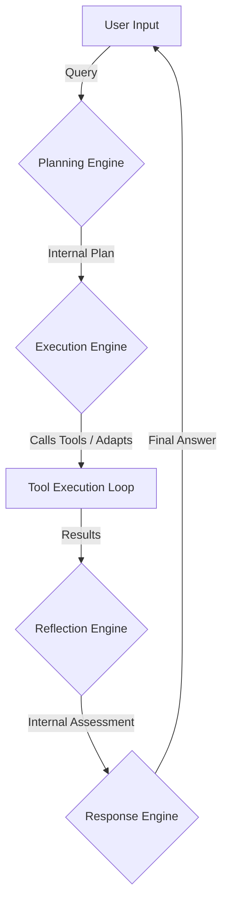
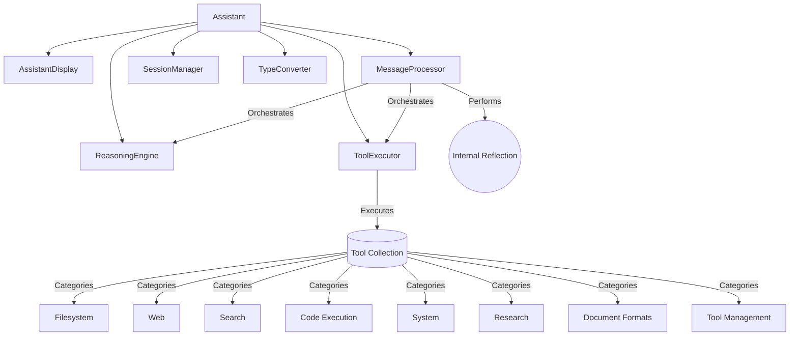
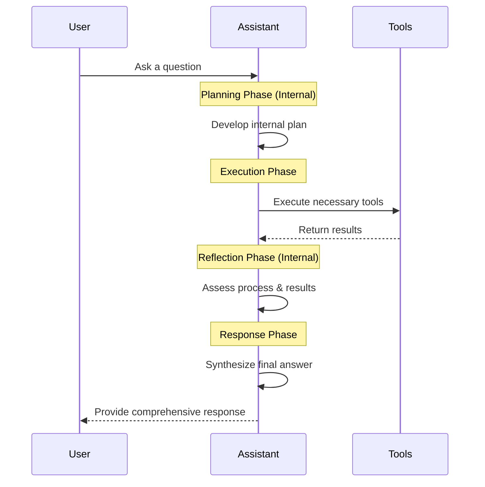
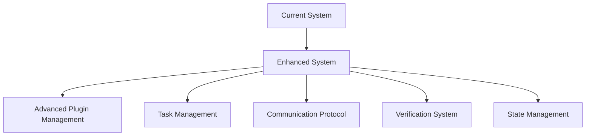
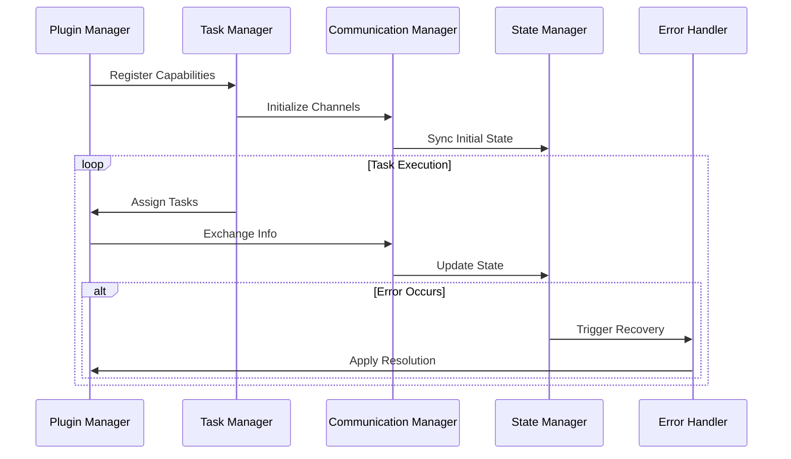

# Gem-assist-linux: Enhanced Terminal-based AI Assistant

<p align="center">
  
  
  
</p>

> **Important Note**: This is a significantly improved Linux fork of [Fus3n's gem-assist](https://github.com/Fus3n/gem-assist) with numerous enhancements, bug fixes, and new features to make it fully functional on Linux systems.

Gem-assist-linux is a powerful terminal-based AI assistant powered by Google's Gemini models. It employs an **agentic workflow** involving planning, dynamic tool execution, and self-reflection, along with an expanded toolset, to provide intelligent assistance directly in your terminal.

## 🔄 Fork Improvements

This Linux fork provides substantial improvements over the original project:

- **Agentic Workflow**: Implemented a more dynamic workflow including planning, execution, and self-reflection.
- **Enhanced Terminal UI**: Improved console interaction and display formatting.
- **Refined Tool Set**: Added numerous new tools and consolidated others for better quality and usability (now 30 tools).
- **YouTube Transcript Analysis**: Added capability to extract and analyze video content.
- **Consolidated Web Scraping**: Merged multiple web tools into a single powerful `advanced_web_scrape` tool.
- **Research Tools**: New tools for scholarly research and academic paper analysis.
- **Linux Compatibility**: Fixed various issues that prevented proper functionality on Linux systems.
- **Comprehensive System Information**: Enhanced system information collection and reporting.
- **Improved Prompting**: Enhanced system prompts for more efficient tool usage and creative problem-solving.
- **Sophisticated Re-planning Strategies**: Implemented more explicit LLM instructions, error-specific strategies, and a critique step for re-planning upon tool execution errors.
- **Integrated Reflection in Response**: Utilized insights from the Reflection Phase to refine the final assistant output, improving response quality.

## 🌟 Key Features

- **Agentic Workflow**: Plans approach, executes tools dynamically, reflects on the process, and then responds.
- **Rich Tool Ecosystem**: **30 specialized tools** across 8 categories for file operations, web interaction, code execution, research, and more.
- **Research Capabilities**: Direct access to academic papers through arXiv integration.
- **YouTube Analysis**: Extract and analyze video transcripts.
- **Efficient Web Strategy**: Prompting guides the assistant to use broad searches followed by targeted content extraction with the `advanced_web_scrape` tool to avoid rate limits.
- **Local File Access**: Read and manipulate various file types including Excel files, plus text extraction from PDFs/Word via `filesystem.read_file`.
- **Customizable**: Easy configuration through YAML files and settings.

## 🏗️ Architecture

Gem-assist-linux uses an agentic approach to solve problems:

1.  **Planning Phase**: The assistant first analyzes the query and determines the necessary steps and tools, following efficiency guidelines (e.g., for web searches). (This plan is usually internal or shown concisely in debug mode).
2.  **Execution Phase**: The assistant executes the planned tool calls sequentially, potentially adapting based on results or using creative fallbacks (e.g., `run_shell_command`) if specific tools fail or are missing.
3.  **Reflection Phase (Internal)**: After execution, the assistant internally assesses the process, the quality of gathered information, and its confidence level.
4.  **Response Phase**: The assistant synthesizes the gathered information, potentially informed by the reflection, to generate the final response for the user.

> **Note**: The architecture diagrams below will render properly on GitHub and GitLab. In other environments, you'll see the diagram code instead.



### Core Components

The assistant consists of several interconnected components that work together:

- **Assistant**: Central coordinator that manages the conversation.
- **MessageProcessor**: Handles the agentic workflow (Planning -> Execution -> Reflection -> Response).
- **ReasoningEngine**: Performs the initial planning step.
- **ToolExecutor**: Executes individual tool calls.
- **Reflection Engine (within MessageProcessor)**: Assesses the execution process and results.
- **SessionManager**: Manages conversation history and persistence.
- **Tool Collection**: Library of **30 specialized tools** across 8 categories.



## 🚀 Getting Started

### Prerequisites

- Python 3.11 or higher
- [uv](https://docs.astral.sh/uv/getting-started/installation/) (for dependency management)
- Google Gemini API key ([get one here](https://aistudio.google.com/apikey))

### Installation

1.  **Clone the repository**:
    ```bash
    git clone https://github.com/DragonL57/gem-assist-linux.git
    cd gem-assist-linux
    ```

2.  **Install core dependencies**:
    ```bash
    uv pip install -e .
    ```

3.  **Install optional dependencies** (based on your needs):
    ```bash
    # For all optional dependencies
    uv pip install -e ".[all]"

    # Or install specific feature groups (e.g., web scraping needs selenium)
    uv pip install -e ".[web, research, document_formats, code_execution]"
    ```
    *Note: See `pyproject.toml` for available extras.*

4.  **Configure API keys**:
    Create a `.env` file in the project root with your API keys:
    ```
    GEMINI_API_KEY=your_api_key_here
    REDDIT_ID=your_reddit_client_id  # Optional for reddit search tool
    REDDIT_SECRET=your_reddit_client_secret  # Optional for reddit search tool
    ```

## 📋 Usage

Run the main script to start the chat interface:

```bash
uv run main.py
```

You'll see a chat interface where you can interact with the assistant. The conversation follows this general workflow:

1.  You ask a question.
2.  The assistant internally plans the steps (Planning Phase).
3.  The assistant executes necessary tools (Execution Phase).
4.  The assistant internally reflects on the process (Reflection Phase).
5.  The assistant synthesizes the information and provides a response.



### Commands

Type `/help` to see available commands. Some useful ones include:

- `/exit` or `/quit` - Exit the chat
- `/save [name]` - Save the current session
- `/load [name]` - Load a saved session
- `/reset` - Reset the current session
- `/reasoning` - Show the assistant's initial plan for the last response (if debug enabled)

## 🛠️ Tool Categories

Gem-assist-linux includes tools across 8 consolidated categories:

| Category | Example Tools | Description |
|----------|---------------|-------------|
| **`filesystem`** | `list_dir`, `read_file`, `write_file`, `zip_archive_files`, `get_file_metadata` | Interact with local files, directories, and archives. `read_file` handles text extraction from PDF/DOCX. |
| **`web`** | `advanced_web_scrape`, `http_get_request`, `download_file_from_url`, `get_youtube_transcript` | Fetch, scrape, extract content (text, smart, structured, tables, dynamic JS), and interact with web resources. |
| **`search`** | `web_search`, `reddit_search` | Perform searches on the web or specific platforms like Reddit. |
| **`code_execution`** | `execute_python_code`, `analyze_pandas_dataframe` | Execute Python code snippets and perform data analysis with Pandas. |
| **`system`** | `run_shell_command`, `get_system_info`, `run_parallel_commands` | Interact with the operating system, run shell commands, and get system details. |
| **`research`** | `get_arxiv_paper` | Access and analyze academic papers from arXiv. |
| **`document_formats`** | `read_excel_file`, `read_excel_structure`, `convert_excel_to_format` | Work specifically with complex document formats like Excel spreadsheets. |
| **`tool_management`** | `find_tools` | Meta-tools for discovering available tools. |

## ⚙️ Configuration

Configuration is primarily managed through YAML files in the `config/` directory (`settings.yml`, `prompts.yml`, etc.) and environment variables (`.env` file). Key settings include:

-   **Model Selection**: Defined in `config/settings.yml` (e.g., `MODEL: "gemini/gemini-2.0-flash"`)
-   **Assistant Name**: Defined in `config/settings.yml`
-   **Model Parameters**: (Temperature, Top P, Max Tokens) in `config/settings.yml`
-   **Debug Mode**: Set `DEBUG_MODE: true` in `config/settings.yml` to see planning and reflection details.
-   **API Keys**: Set in the `.env` file.

**Note**: Restart the application after making changes to configuration files or `.env`.

## 🧪 Testing

To run tests:

```bash
uv run pytest tests/
```

## 🔍 Workflows

Gem-assist-linux supports various workflows leveraging its agentic nature and tools:

### Research Workflow
1.  **Plan:** Identify need for web search (1-3 broad queries) and content extraction.
2.  **Execute:** Perform `web_search`, analyze results, then use `advanced_web_scrape` (mode='smart') on relevant URLs.
3.  **Reflect:** (Internal) Assess quality of search results and extracted text.
4.  **Respond:** Synthesize extracted content into a summary or answer.

### Paper Analysis Workflow
1.  **Plan:** Identify need for arXiv tool.
2.  **Execute:** Use `get_arxiv_paper`
3.  **Reflect:** (Internal) Evaluate the paper's relevance and summary quality.
4.  **Respond:** Provide insights based on the paper.

### YouTube Analysis Workflow
1.  **Plan:** Identify need for YouTube tool.
2.  **Execute:** Use `get_youtube_transcript`.
3.  **Reflect:** (Internal) Check transcript quality.
4.  **Respond:** Summarize the video content based on the transcript.

## 🤝 Contributing

Contributions are welcome! Please feel free to submit a Pull Request.

1.  Fork the repository
2.  Create your feature branch: `git checkout -b feature/amazing-feature`
3.  Commit your changes: `git commit -m 'Add some amazing feature'`
4.  Push to the branch: `git push origin feature/amazing-feature`
5.  Open a Pull Request

## 📝 License

This project is a fork of the original [gem-assist](https://github.com/Fus3n/gem-assist) by Fus3n, with significant modifications and improvements by DragonL57. It is licensed under the BSD 3-Clause License - see the [LICENSE](LICENSE) file for details.

## ⚠️ Known Issues

-   Web interaction tools may hit rate limits (mitigated by search strategy in prompts).
-   File download tool might not show progress correctly for dynamic endpoints.
-   Some features require additional dependencies (check `pyproject.toml` extras).
-   Selenium-based dynamic scraping (`advanced_web_scrape` with `render_js=True`) requires a compatible WebDriver (e.g., chromedriver) installed and accessible in the system PATH.

## ✨ Research-Based Future Enhancements

Based on comprehensive Multi-Agent Systems (MAS) research, we've identified the following key areas for enhancement:



### 1. Advanced Plugin Management System
**Research Context**: Addresses "Poorly Defined Agent Roles" and "System Architecture Limitations"
- **Plugin Role Definition Framework**
  - Strict role boundaries and capability declarations
  - Resource access control and conflict prevention
  - Runtime capability negotiation
- **Plugin Interaction Manager**
  - Clear communication channels between plugins
  - Resource sharing protocols
  - Conflict resolution mechanisms

### 2. Enhanced Task Decomposition and Verification
**Research Context**: Addresses "Inadequate Task Decomposition" and "Solution Correctness Verification"
- **Smart Task Analyzer**
  - Dynamic task breakdown with dependency tracking
  - Subtask priority management
  - Resource requirement analysis
- **Verification Pipeline**
  - Multi-stage result validation
  - Completion criteria enforcement
  - Integration testing framework

### 3. Inter-Agent Communication Protocol
**Research Context**: Addresses "Communication Issues" and "Inefficient Information Exchange"
- **Structured Message System**
  - Standardized communication formats
  - Priority-based message routing
  - State synchronization protocol
- **Knowledge Sharing Framework**
  - Centralized knowledge repository
  - Real-time capability discovery
  - Context-aware information distribution

### 4. State Management System
**Research Context**: Addresses "Conflicting Goals" and "Common Knowledge"
- **Transaction Management**
  - Atomic operations support
  - State rollback capabilities
  - Consistency enforcement
- **Shared Context Manager**
  - Global state tracking
  - Cross-plugin state synchronization
  - History-aware operation management

### 5. Advanced Error Recovery Framework
**Research Context**: Addresses "Premature Termination" and "Agent Contributions Synthesis"
- **Distributed Error Handler**
  - Multi-level error recovery
  - Context-aware error resolution
  - Graceful degradation support
- **Result Synthesis Engine**
  - Smart result aggregation
  - Partial result handling
  - Quality-aware output generation

### Implementation Strategy



### Technical Impact
1. **Reliability Improvements**
   - Reduced system failures through advanced error handling
   - Better recovery mechanisms for plugin failures
   - More consistent results with enhanced verification

2. **Performance Enhancements**
   - Optimized task distribution with smart analysis
   - Reduced communication overhead through structured protocols
   - Faster error resolution with context-aware handling

3. **Scalability Benefits**
   - Streamlined plugin integration with clear boundaries
   - Better resource utilization through coordinated management
   - Improved system flexibility with modular architecture

These improvements address the core challenges identified in MAS research, focusing on:
- Clear agent role definitions and responsibilities
- Effective task decomposition and distribution
- Robust communication and coordination protocols
- Comprehensive verification and quality assurance
- Efficient error recovery and result synthesis

---

<p align="center">
  <em>Gem-assist-linux: Your intelligent terminal companion for Linux</em><br>
  <small>Original project by <a href="https://github.com/Fus3n/gem-assist">Fus3n</a> | Enhanced Linux fork by <a href="https://github.com/DragonL57">DragonL57</a></small>
</p>
