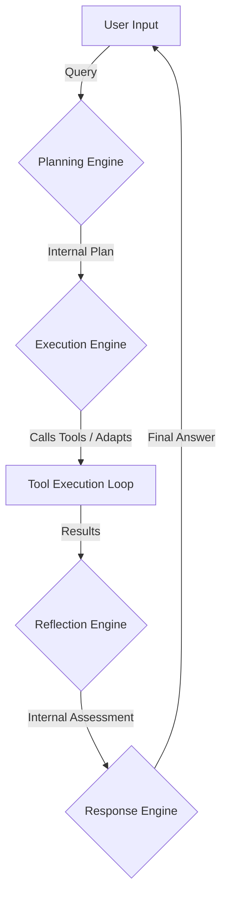
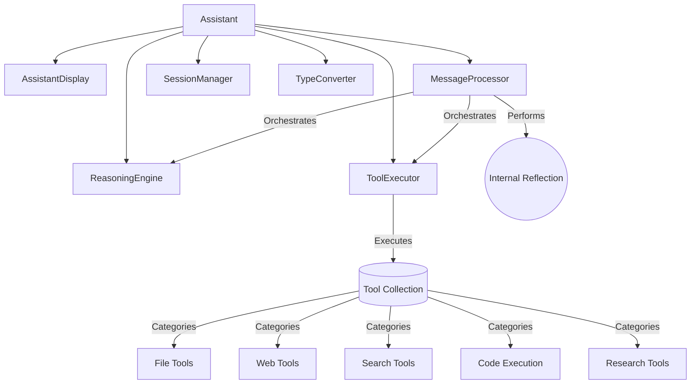
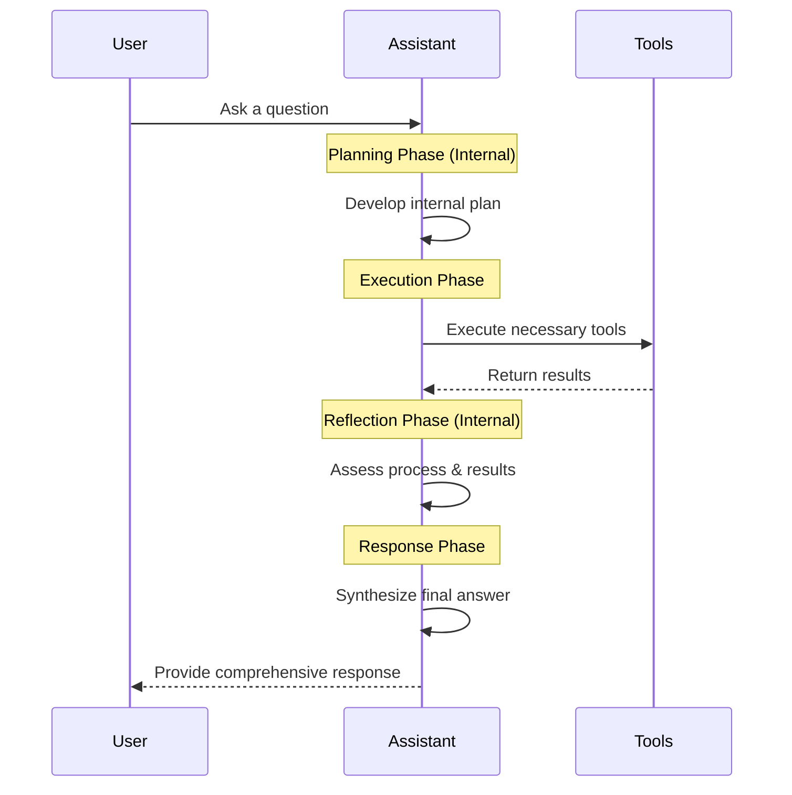

# Gem-assist-linux: Enhanced Terminal-based AI Assistant

<p align="center">
  
  
  
</p>

> **Important Note**: This is a significantly improved Linux fork of [Fus3n's gem-assist](https://github.com/Fus3n/gem-assist) with numerous enhancements, bug fixes, and new features to make it fully functional on Linux systems.

Gem-assist-linux is a powerful terminal-based AI assistant powered by Google's Gemini models. It employs an **agentic workflow** involving planning, dynamic tool execution, and self-reflection, along with an expanded toolset, to provide intelligent assistance directly in your terminal.

## 🔄 Fork Improvements

This Linux fork provides substantial improvements over the original project:

- **Agentic Workflow**: Implemented a more dynamic workflow including planning, execution, and self-reflection.
- **Enhanced Terminal UI**: Improved console interaction and display formatting.
- **Extended Tool Set**: Added numerous new tools including arXiv research paper integration.
- **YouTube Transcript Analysis**: Added capability to extract and analyze video content.
- **Improved Web Content Extraction**: Better handling of complex websites and content extraction.
- **Research Tools**: New tools for scholarly research and academic paper analysis.
- **Linux Compatibility**: Fixed various issues that prevented proper functionality on Linux systems.
- **Comprehensive System Information**: Enhanced system information collection and reporting.

## 🌟 Key Features

- **Agentic Workflow**: Plans approach, executes tools dynamically, reflects on the process, and then responds.
- **Rich Tool Ecosystem**: 40+ specialized tools for file operations, web searches, code execution, and more.
- **Research Capabilities**: Direct access to academic papers through arXiv integration.
- **YouTube Analysis**: Extract and analyze video transcripts.
- **Efficient Web Strategy**: Smart search tools to avoid rate limits while maximizing information quality.
- **Local File Access**: Read and manipulate various file types including PDFs, Word documents, and Excel files.
- **Customizable**: Easy configuration through YAML files and settings.

## 🏗️ Architecture

Gem-assist-linux uses an agentic approach to solve problems:

1.  **Planning Phase**: The assistant first analyzes the query and determines the necessary steps and tools. (This plan is usually internal or shown concisely in debug mode).
2.  **Execution Phase**: The assistant executes the planned tool calls sequentially, potentially adapting based on results (adaptation logic is under development).
3.  **Reflection Phase (Internal)**: After execution, the assistant internally assesses the process, the quality of gathered information, and its confidence level.
4.  **Response Phase**: The assistant synthesizes the gathered information, potentially informed by the reflection, to generate the final response for the user.

> **Note**: The architecture diagrams below will render properly on GitHub and GitLab. In other environments, you'll see the diagram code instead.



### Core Components

The assistant consists of several interconnected components that work together:

- **Assistant**: Central coordinator that manages the conversation.
- **MessageProcessor**: Handles the agentic workflow (Planning -> Execution -> Reflection -> Response).
- **ReasoningEngine**: Performs the initial planning step.
- **ToolExecutor**: Executes individual tool calls.
- **Reflection Engine (within MessageProcessor)**: Assesses the execution process and results.
- **SessionManager**: Manages conversation history and persistence.
- **Tool Collection**: Library of 40+ specialized tools across categories.



## 🚀 Getting Started

### Prerequisites

- Python 3.11 or higher
- [uv](https://docs.astral.sh/uv/getting-started/installation/) (for dependency management)
- Google Gemini API key ([get one here](https://aistudio.google.com/apikey))

### Installation

1.  **Clone the repository**:
    ```bash
    git clone https://github.com/DragonL57/gem-assist-linux.git
    cd gem-assist-linux
    ```

2.  **Install core dependencies**:
    ```bash
    uv pip install -e .
    ```

3.  **Install optional dependencies** (based on your needs):
    ```bash
    # For all optional dependencies
    uv pip install -e ".[all]"

    # Or install specific feature groups
    uv pip install -e ".[data-analysis,web-scraping,dynamic-web,documents]"
    ```

4.  **Configure API keys**:
    Create a `.env` file in the project root with your API keys:
    ```
    GEMINI_API_KEY=your_api_key_here
    REDDIT_ID=your_reddit_client_id  # Optional
    REDDIT_SECRET=your_reddit_client_secret  # Optional
    ```

## 📋 Usage

Run the main script to start the chat interface:

```bash
uv run main.py
```

You'll see a chat interface where you can interact with the assistant. The conversation follows this general workflow:

1.  You ask a question.
2.  The assistant internally plans the steps (Planning Phase).
3.  The assistant executes necessary tools (Execution Phase).
4.  The assistant internally reflects on the process (Reflection Phase).
5.  The assistant synthesizes the information and provides a response.



### Commands

Type `/help` to see available commands. Some useful ones include:

- `/exit` or `/quit` - Exit the chat
- `/save [name]` - Save the current session
- `/load [name]` - Load a saved session
- `/reset` - Reset the current session
- `/reasoning` - Show the assistant's initial plan for the last response (if debug enabled)

## 🛠️ Tool Categories

Gem-assist-linux includes tools across several categories:

| Category | Tools | Description |
|----------|-------|-------------|
| **File System** | `list_dir`, `read_file`, `write_file`, etc. | Interact with local files and directories |
| **Web** | `get_website_text_content`, `smart_content_extraction`, `get_youtube_transcript` | Extract and process web content |
| **Search** | `web_search`, `reddit_search` | Find information online |
| **Document Processing** | `read_excel_file`, `read_pdf_text`, `convert_document` | Work with various document formats |
| **Code Execution** | `execute_python_code`, `analyze_pandas_dataframe` | Run Python code and analyze data |
| **Research** | `get_arxiv_paper`, `summarize_research_paper` | Access and analyze academic papers |
| **System** | `get_system_info`, `run_shell_command` | Interact with your operating system |

## ⚙️ Configuration

Configuration is primarily managed through YAML files in the `config/` directory (`settings.yml`, `prompts.yml`, etc.) and environment variables (`.env` file). Key settings include:

-   **Model Selection**: Defined in `config/settings.yml` (e.g., `MODEL: "gemini/gemini-2.0-flash"`)
-   **Assistant Name**: Defined in `config/settings.yml`
-   **Model Parameters**: (Temperature, Top P, Max Tokens) in `config/settings.yml`
-   **Debug Mode**: Set `DEBUG_MODE: true` in `config/settings.yml` to see planning and reflection details.
-   **API Keys**: Set in the `.env` file.

**Note**: Restart the application after making changes to configuration files or `.env`.

## 🧪 Testing

To run tests:

```bash
uv run pytest tests/
```

## 🔍 Workflows

Gem-assist-linux supports various workflows leveraging its agentic nature and tools:

### Research Workflow
1.  **Plan:** Identify need for web search and content extraction.
2.  **Execute:** Perform `web_search`, then `get_website_text_content` on results.
3.  **Reflect:** (Internal) Assess quality of search results and extracted text.
4.  **Respond:** Synthesize extracted content into a summary or answer.

### Paper Analysis Workflow
1.  **Plan:** Identify need for arXiv tool.
2.  **Execute:** Use `get_arxiv_paper`, potentially followed by `summarize_research_paper`.
3.  **Reflect:** (Internal) Evaluate the paper's relevance and summary quality.
4.  **Respond:** Provide insights based on the paper.

### YouTube Analysis Workflow
1.  **Plan:** Identify need for YouTube tool.
2.  **Execute:** Use `get_youtube_transcript`.
3.  **Reflect:** (Internal) Check transcript quality.
4.  **Respond:** Summarize the video content based on the transcript.

## 🤝 Contributing

Contributions are welcome! Please feel free to submit a Pull Request.

1.  Fork the repository
2.  Create your feature branch: `git checkout -b feature/amazing-feature`
3.  Commit your changes: `git commit -m 'Add some amazing feature'`
4.  Push to the branch: `git push origin feature/amazing-feature`
5.  Open a Pull Request

## 📝 License

This project is a fork of the original [gem-assist](https://github.com/Fus3n/gem-assist) by Fus3n, with significant modifications and improvements by DragonL57. It is licensed under the BSD 3-Clause License - see the [LICENSE](LICENSE) file for details.

## ⚠️ Known Issues

-   Web interaction tools may hit rate limits.
-   File download tool might not show progress correctly for dynamic endpoints.
-   Some features require additional dependencies.

## ✨ Future Enhancements

Potential areas for future development include:

-   **Sophisticated Re-planning Strategies:** Enhance re-planning with more explicit LLM instructions, error-specific strategies, and a critique step.
-   **Integrate Reflection into Response:** Utilize the Reflection Phase insights to refine the final assistant output.
-   **Enhanced Error Handling:** Introduce more specific exception types for nuanced error handling and re-planning.
-   **Advanced Context Management:** Implement techniques like summarization or selective context inclusion for long conversations.
-   **Robust Tool Management:** Improve tool loading/discovery and potentially allow LLM selection of tool subsets.
-   **Comprehensive Testing:** Expand test coverage for the agentic flow, error handling, and individual tools.
-   **Configuration Improvements:** Explore dynamic configuration loading or a CLI for settings management.
-   **Asynchronous Operations:** Ensure all blocking tool operations are correctly handled asynchronously.
-   **User Feedback Integration:** Develop mechanisms to incorporate explicit user feedback.

---

<p align="center">
  <em>Gem-assist-linux: Your intelligent terminal companion for Linux</em><br>
  <small>Original project by <a href="https://github.com/Fus3n/gem-assist">Fus3n</a> | Enhanced Linux fork by <a href="https://github.com/DragonL57">DragonL57</a></small>
</p>
